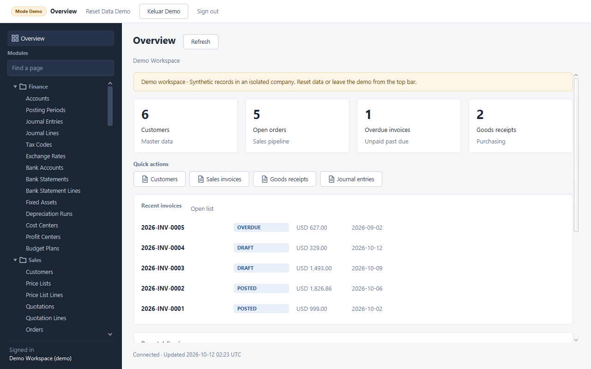
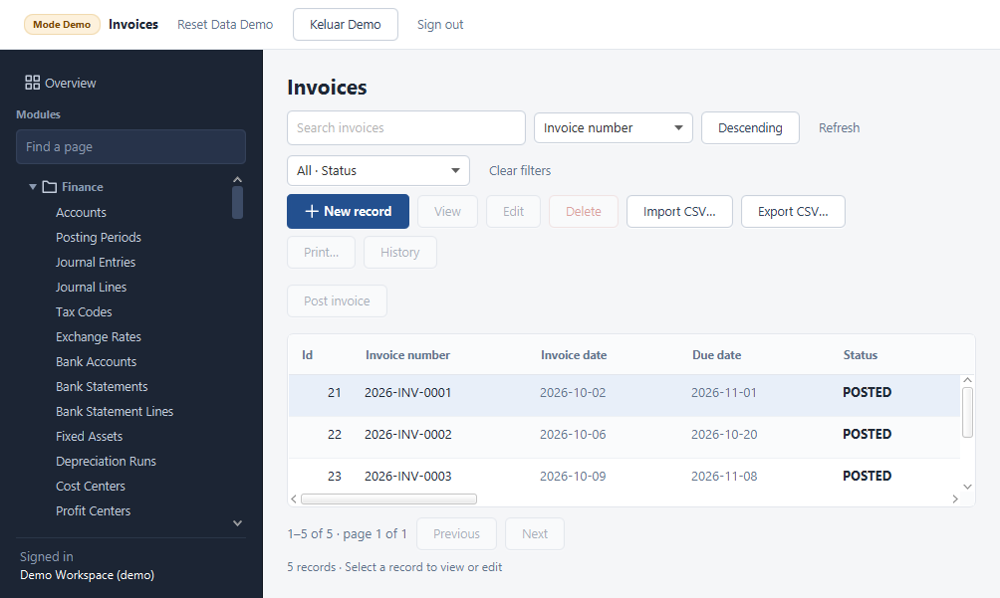

# Portfolio completion report — 12 October 2026

The existing three-module ERP now has a consistent JavaFX record workspace, accessible server business actions, working demo documents and reproducible acceptance checks. The implementation preserves the registry, services, repositories, historical migrations, JWT tenancy and optimistic locking. Views remain programmatic JavaFX; introducing FXML would have been an unnecessary architectural rewrite.

## Completed

| Area | Changed files | Result and reason |
|---|---|---|
| REST transport | `ApiClient.java`, `ApiClientTest.java` | JSON media types are explicit; CSV imports use `/import`; exports carry the same search, filters and sort as the table. Business URLs match server routes. Monetary JSON stays `BigDecimal`, preserving large values. A late rejected request cannot discard a newer session. |
| Shared record workspace | `EntityView.java`, `EntityMeta.java`, `Ui.java`, `Values.java` | New, View, Edit and Delete have distinct behavior and appropriate loading/selection/posted/read-only guards. Server search, enum/boolean filters, sort and 50-row paging work together; last-page deletion clamps correctly. Success/error/empty/loading states reflect real operations. Disposed screens cancel reads and ignore late callbacks. Numeric overflow and malformed booleans fail validation. |
| Forms and inspection | `RecordDialog.java`, `ReferencePicker.java`, `RecordDetails.java`, `HistoryDialog.java`, core `ReferenceValidation.java`/`CrudResource.java` | Forms preserve constructor defaults, use typed controls, focus validation failures and select related records through scoped searches rather than requiring memorized IDs. View includes generated records. Administrator history shows actual audit events and before/after values. Print generates paginated record summaries. |
| Business actions | `RecordActions.java`, `SalesService.java`, `PurchasingActionsResource.java` | Existing invoice/receipt posting, delivery shipping, vendor matching, hold release and journal reversal are reachable through guarded commands with confirmations and feedback. Shipping and matching have document-specific audit events in the transaction. Generated and posted rows remain protected from ordinary CRUD writes. |
| Shell and overview | `MainWindow.java`, `OverviewView.java`, `OverviewResource.java` | Overview is always reachable. It uses live counts, documents, audit activity, quick navigation and refresh timestamps. Overdue counts include unpaid past-due invoices. Compact layouts scroll and use two metric columns. Normal users retain a password-change action. Demo controls and busy indicators occupy space only when visible. |
| Design consistency | `Icons.java`, `app.css`, `Ui.java`, `docs/DESIGN-SYSTEM.md` | Shared semantic colors, Segoe UI typography, 8/16/24px spacing, local 16px vector icons, stable focus borders, coherent dialogs and 40px table rows. Invalid CSS properties and incorrectly combined pill classes were repaired. |
| Security and metadata | `RecordPolicy.java`, `CrudResource.java`, `AuthResource.java` | Metadata follows the same authorization as records; company administration requires ADMIN and currency writes require ADMIN. Demo access is scoped even on shared endpoints; identity/security administration is read-only. Legacy demo-owned accounts cannot obtain normal sessions. A normal account named `demo` can sign in and change its own password; demo tokens cannot change it. Password lookup uses the token's company. Account CSV import is explicitly unavailable because passwords belong in the account form. |
| Demo business data | `DemoData.java`, document entity defaults, `DemoWorkspaceTest.java` | Invoice, delivery, receipt and vendor-invoice seed lines carry the demo company. Missing legacy line ownership is repaired only through a proven demo parent. Vendor line tax is seeded. Real seeded invoices/receipts post, vendor invoices match/post, shipments update stock, and reset removes the old tenant's lines. New documents use valid initial statuses. |
| Embedded startup and distribution | `Main.java`, `DesktopEnvironment.java`, `DesktopApp.java`, `EmbeddedRuntime.java`, `RuntimeConfigSource.java`, launch/package scripts | The desktop configures its environment before startup, uses a concrete embedded Quarkus application on a separate lifecycle thread and polls readiness without blocking JavaFX. Shutdown drains the service without interrupting it. Signing keys load from directories with spaces. Portable packaging supplies normal and demo launchers and a Java runtime, including the required `jdk.zipfs` JAR provider. |
| Repeatable QA and documentation | regression tests, `PortfolioScenario.java`, `PortfolioCapture.java`, `Verify-Portfolio.ps1`, `README.md`, audit/design/report docs | QA uses a disposable local PostgreSQL cluster, free ports and separate keys. The live walkthrough drives real JavaFX controls and REST persistence; screenshots reject blank images. Documentation describes implemented capabilities and boundaries. |

## Verification

The latest Surefire reports contain **48 tests, zero failures, zero errors and zero skipped tests**: core 12, backend workflows 11, demo isolation/workflows 10, desktop transport/conversion 3 and JavaFX views 12.

| Check | Result | Local evidence |
|---|---|---|
| Full Maven reactor | BUILD SUCCESS; 48 tests passed | `.local/portfolio-final-verify.log` |
| Core/desktop verification after lifecycle correction | BUILD SUCCESS; 27 tests passed | `.local/portfolio-lifecycle-verify.log` |
| Real PostgreSQL business and JavaFX walkthrough | PASS | `.local/portfolio-live-qa.log` |
| Embedded demo using the bundle's own Java runtime | PASS, including clean service shutdown | `.local/portfolio-bundled-runtime.log` |
| Actual `ERP-Demo.exe` startup and demo API/UI walkthrough | PASS | `.local/portfolio-native-smoke.log` |
| Windows application image | Built successfully; packaged runner matches the source runner's SHA-256 | `.local/portfolio-native-final.log` |

The verified Windows bundle is **`dist/portfolio-20261012-120337/ERP-Workspace`**, containing `ERP-Workspace.exe` and `ERP-Demo.exe`. Earlier timestamped bundles were intermediate builds; use this directory. Configure PostgreSQL with the included `Configure-Neon.ps1` before launching on another Windows account/computer. The Java runtime is bundled.

The native check starts the real executable and waits for its embedded service. A separate JavaFX test client then walks demo sign-in, lists and confirmations against that service. The bundled-runtime check runs the desktop and embedded service together and verifies graceful shutdown. QA processes and the disposable PostgreSQL service were stopped after verification.

The live PostgreSQL acceptance walkthrough has passed navigation, required-field validation, customer create/edit and persisted search results, audit history, record inspection, related-record selection, document defaults, filters, actual invoice posting, posted edit locks, compact layouts and CSV import/export. The current captures are in `docs/screenshots/portfolio`.





The automated catalog checks build/style all 118 registered record pages and request every catalog metadata/list route. They exercise representative shared forms and workflows; this does not claim a manual execution of every possible business-field combination.

## Remaining issues and recommendations

- Payroll calculations, MRP optimization, scheduled report delivery, binary document storage, external integrations and offline synchronization remain domain extensions. Their current pages manage records and definitions; they do not execute those engines. Full payment allocation/bank reconciliation and jurisdiction-specific accounting also need further domain design.
- Inventory posting supports standard cost and moving average. FIFO/LIFO are explicitly rejected; do not present those methods as supported.
- Granular enterprise permissions remain a further extension. Current role restrictions and company isolation are enforced and tested.
- Physical printer output, screen-reader behavior and OS-level keyboard traversal require device testing. Shared keyboard handlers and JavaFX rendering were checked, but these are not accessibility certification.
- The package is an unsigned Windows application folder, with a bundled Java runtime. It requires a reachable PostgreSQL database and a connection profile created for the current Windows account; it does not bundle PostgreSQL or replace a signed installer/deployment process.
- The pinned Flyway version emits compatibility warnings for the local PostgreSQL 18.3 and test H2 2.3 versions, although migration validation and integration checks passed. Recheck the chosen deployment database version when updating the Quarkus/Flyway stack. JavaFX also logs its intentional classpath/unnamed-module configuration; the native and bundled-runtime checks passed with that configuration.
- Legacy unscoped demo child rows are repaired only when their parent still proves demo ownership. Rows whose parents have already disappeared cannot safely be attributed to a tenant. Review such historical rows with a database administrator rather than deleting unknown rows automatically.
- The workspace has no Git checkout. No commit, pull request or publication was created. Source, audit, tests, screenshots and native artifacts are available locally for review and later repository publishing.

## Reproduce

```powershell
$env:JAVA_HOME = 'C:\Program Files\Java\jdk-21.0.12.1'
./mvnw.cmd verify -B
pwsh -NoProfile -File scripts/Verify-Portfolio.ps1 -JavaHome "$env:JAVA_HOME"
pwsh -NoProfile -File scripts/Verify-Portfolio.ps1 -JavaHome "$env:JAVA_HOME" -Embedded
pwsh -NoProfile -File scripts/Build-Portable.ps1 -SkipBuild
# After packaging, also check that specific bundle:
pwsh -NoProfile -File scripts/Verify-Portfolio.ps1 -JavaHome 'dist/portfolio-20261012-120337/ERP-Workspace/runtime' -Embedded
pwsh -NoProfile -File scripts/Verify-Portfolio.ps1 -JavaHome "$env:JAVA_HOME" -NativeDemoLauncher 'E:\my project\javaspring\erp-dekstop-app\dist\portfolio-20261012-120337\ERP-Workspace\ERP-Demo.exe'
```

`-SkipBuild` is appropriate only after verification has built the current runner. `Verify-Portfolio.ps1` requires PowerShell 7 and PostgreSQL binaries; it starts/stops only its own local QA services and does not read the saved Neon profile. Use `ERP_DEMO_DATABASE_URL` for a dedicated demonstration database. The reserved demo tenant provides logical isolation when sharing a configured database.
